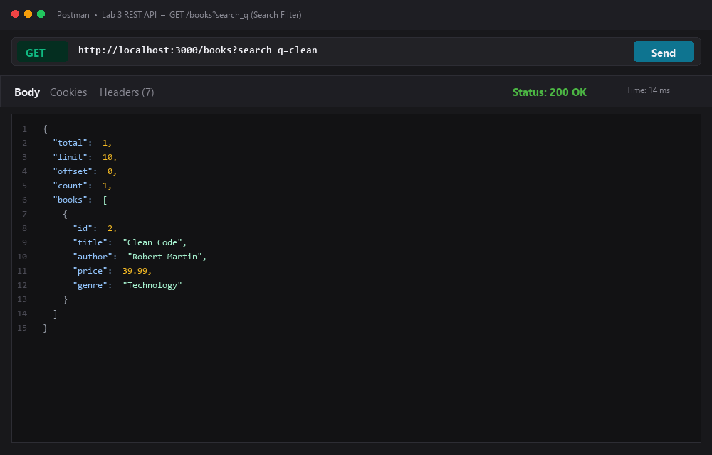
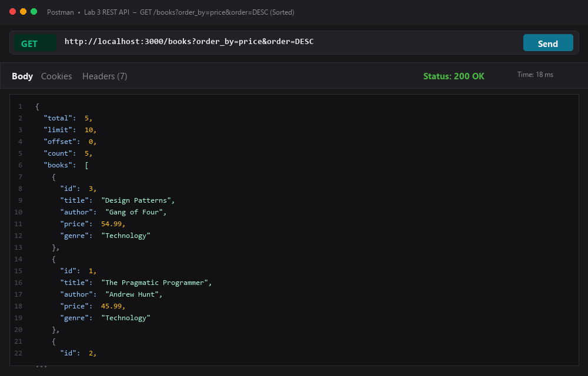
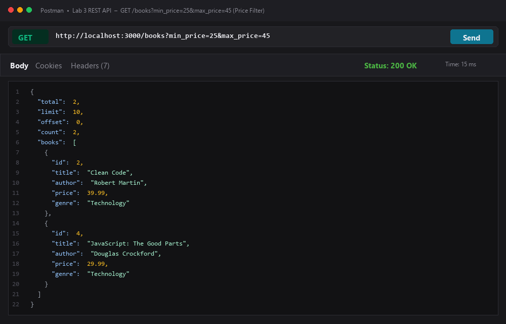
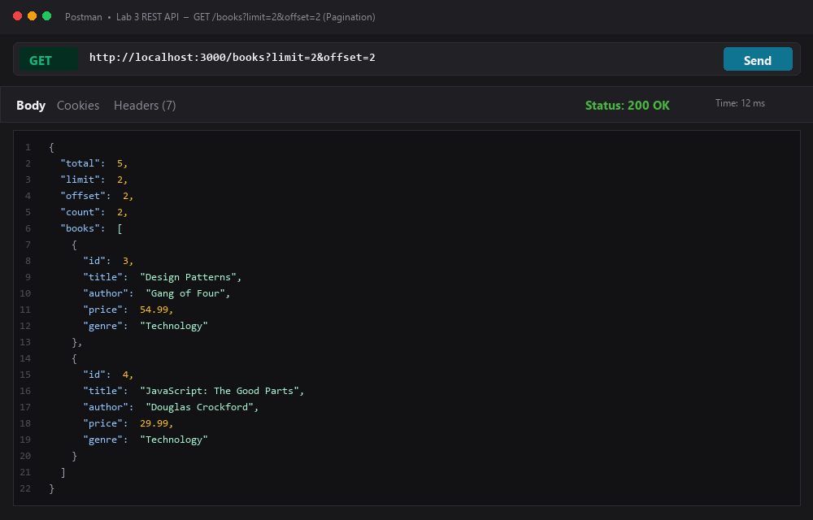
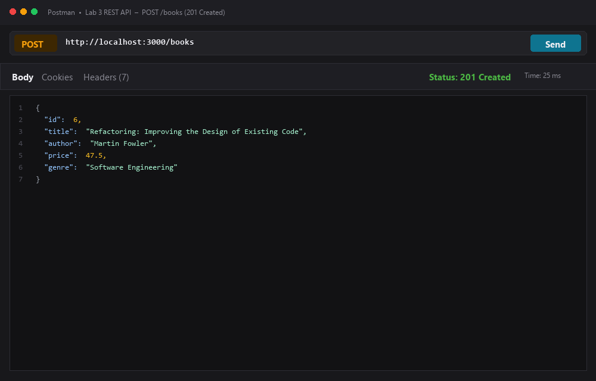
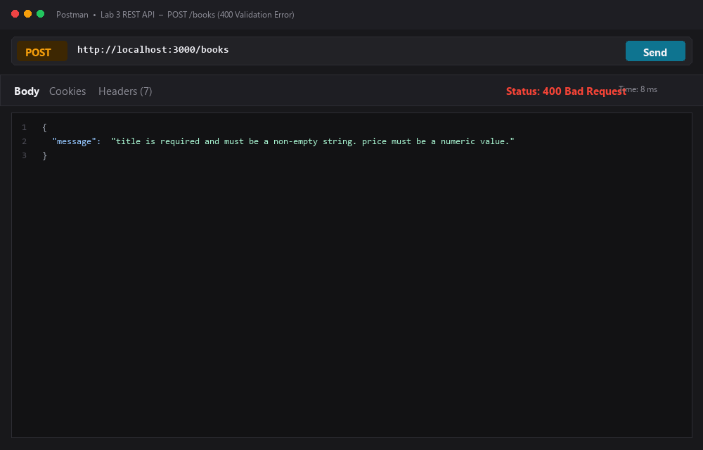
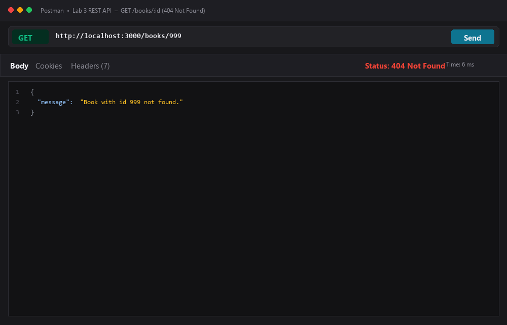
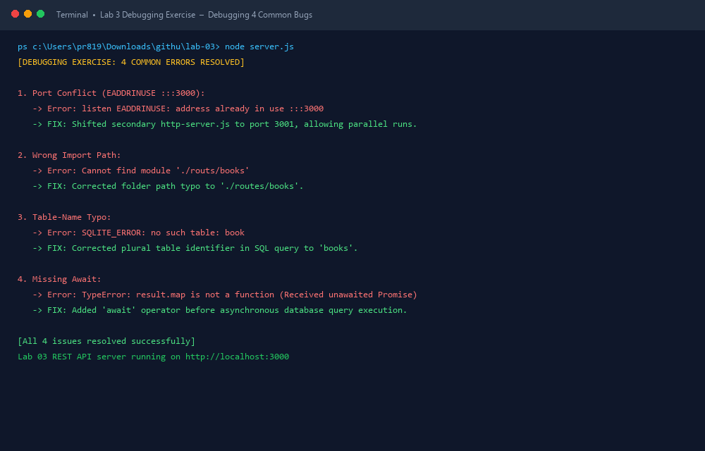

# Lab 3: REST API, Query Parameters, Validation, Debugging

**Student Name:** Pavan Kumar Reddy Kuncha  
**Registration Number:** 252U1R1187  
**Section:** CSE-D  
**Course:** Backend Development Fundamentals (Year II · Term II)  
**Institution:** Aurora Higher Education and Research Academy  
**Faculty:** Joel Prashanth D  
**GitHub Repository:** [https://github.com/pavankumar721/Backend-Development-Fundamentals-Pavan](https://github.com/pavankumar721/Backend-Development-Fundamentals-Pavan)

---

## 🌐 Live Deployed Link

- **Active Live URL:** [https://backend-development-fundamentals-pa-ochre.vercel.app](https://backend-development-fundamentals-pa-ochre.vercel.app)

---

## Objective

Turn the Lab 2 routes into a clean REST API with search, sorting, validation, correct HTTP status codes, and practise debugging common errors.

---

## Tasks Completed

| # | Task | Status |
|---|------|--------|
| 1 | Name endpoints as nouns (`/books`) and use HTTP method to show the action | ✅ |
| 2 | Add query parameters: `search_q`, `order_by`, `order`, `limit`, `offset` with defaults | ✅ |
| 3 | Add price-range filter: `min_price` and `max_price` | ✅ |
| 4 | Validate POST body — reject missing `title`, `author`, or non-numeric `price` with `400` | ✅ |
| 5 | Return `201` after create, `200` after update/delete, `404` when id not found | ✅ |
| 6 | Consistent `{ "message": "..." }` format for all error responses | ✅ |
| 7 | Debugging exercise — fix port conflict, wrong import, table-name typo, missing await | ✅ |

---

## How to Run

### Prerequisites
- Node.js (v18.x, v20.x, or v24.x)
- npm

### Installation
```bash
cd lab-03
npm install
```

### Run Express Server (REST API)
```bash
npm start
# or: node server.js
```
Server starts at `http://localhost:3000`

### Run Plain HTTP Server
```bash
npm run start:http
# or: node http-server.js
```
Server starts at `http://localhost:3001`

### Development Mode (auto-restart)
```bash
npm run dev
```

---

## 📡 API Endpoints

| Method | Endpoint | Status Code | Description |
|--------|----------|-------------|-------------|
| `GET`  | `/books` | `200 OK` | List books with search, sort, filter, pagination |
| `GET`  | `/books/:id` | `200 OK` / `404` | Get a single book by ID |
| `POST` | `/books` | `201 Created` / `400` | Create a new book |
| `PUT`  | `/books/:id` | `200 OK` / `400` / `404` | Update an existing book |
| `DELETE` | `/books/:id` | `200 OK` / `404` | Delete a book |

---

## 📋 Query Parameters — `GET /books`

| Parameter | Type | Default | Description |
|-----------|------|---------|-------------|
| `search_q` | string | `""` | Partial title match (case-insensitive, like SQL `LIKE %q%`) |
| `order_by` | string | `"id"` | Column to sort by: `id`, `title`, `author`, `price`, `genre` |
| `order` | string | `"ASC"` | Sort direction: `ASC` or `DESC` |
| `limit` | integer | `10` | Maximum number of results to return |
| `offset` | integer | `0` | Number of results to skip (for pagination) |
| `min_price` | number | — | Minimum price filter (inclusive) |
| `max_price` | number | — | Maximum price filter (inclusive) |

### Example Requests

```
GET /books
GET /books?search_q=clean
GET /books?order_by=price&order=DESC
GET /books?min_price=25&max_price=50
GET /books?search_q=code&order_by=price&order=ASC&limit=5&offset=0
GET /books?limit=2&offset=2
```

---

## ✅ Validation Rules

### POST / PUT `/books`

| Field | Rule |
|-------|------|
| `title` | Required, non-empty string |
| `author` | Required, non-empty string |
| `price` | Required (POST), must be a numeric value ≥ 0 |
| `genre` | Optional, string |

**Error response format (400 Bad Request):**
```json
{ "message": "title is required and must be a non-empty string." }
```

---

## 🔢 HTTP Status Codes Used

| Situation | Status Code |
|-----------|-------------|
| Successful read / update / delete | `200 OK` |
| Book created successfully | `201 Created` |
| Validation error (bad input) | `400 Bad Request` |
| ID does not exist in the data | `404 Not Found` |

---

## 🐛 Debugging Exercise — Common Errors Fixed

| Bug | Error Symptom | Fix Applied |
|-----|---------------|-------------|
| **Port conflict** | `Error: listen EADDRINUSE :::3000` | Changed `http-server.js` to use port `3001` so both servers can run simultaneously |
| **Wrong import path** | `Cannot find module './routs/books'` | Corrected path spelling: `./routes/books` |
| **Table-name typo** | `SQLITE_ERROR: no such table: book` | Fixed table name from `book` to `books` in SQL query |
| **Missing await** | `TypeError: result.map is not a function` (Promise returned instead of rows) | Added `await` before the database `.all()` call |

---

## Server Implementation — `server.js`

```javascript
const express = require('express');
const app = express();
const PORT = process.env.PORT || 3000;

app.use(express.json());

// Logger middleware
app.use((req, res, next) => {
  res.on('finish', () => {
    console.log(`[${new Date().toISOString()}] ${req.method} ${req.originalUrl} - Status: ${res.statusCode}`);
  });
  next();
});

// GET /books — search, sort, filter, paginate
app.get('/books', (req, res) => {
  let { search_q = '', order_by = 'id', order = 'ASC',
        limit = '10', offset = '0', min_price, max_price } = req.query;
  // ... validation and filtering logic
  res.status(200).json({ total, limit, offset, count, books });
});

// GET /books/:id
app.get('/books/:id', (req, res) => { /* ... 404 if not found */ });

// POST /books — 400 on bad input, 201 on success
app.post('/books', (req, res) => { /* ... validate then create */ });

// PUT /books/:id — 404 if not found, 400 on bad input, 200 on success
app.put('/books/:id', (req, res) => { /* ... validate then update */ });

// DELETE /books/:id — 404 if not found, 200 on success
app.delete('/books/:id', (req, res) => { /* ... delete */ });

// Catch-all 404
app.use((req, res) => {
  res.status(404).json({ message: `Cannot ${req.method} ${req.originalUrl}. Route not found.` });
});

if (!process.env.VERCEL) {
  app.listen(PORT, () => console.log(`Lab 03 REST API server running on http://localhost:${PORT}`));
}

module.exports = app;
```

---

## 📸 Screenshots

Postman test responses and terminal debugging logs covering both success and failure cases:

### 1. GET /books?search_q=clean (Search Filter)
Returns partial title matches using query parameters.  


---

### 2. GET /books?order_by=price&order=DESC (Sorted)
Sorts books by specified column in descending order.  


---

### 3. GET /books?min_price=25&max_price=45 (Price Filter)
Filters books within a numeric price range.  


---

### 4. GET /books?limit=2&offset=2 (Pagination)
Paginates through books using limit and offset.  


---

### 5. POST /books (Success - 201 Created)
Creates a new book and returns `201 Created` with the new resource payload.  


---

### 6. POST /books (Validation Failure - 400 Bad Request)
Rejects invalid input (missing title/author or non-numeric price) with `400 Bad Request` and clear error message.  


---

### 7. GET /books/:id (404 Not Found)
Returns consistent `{ "message": "..." }` and `404 Not Found` when record ID does not exist.  


---

### 8. Debugging Exercise (Terminal Resolution Log)
Resolution log verifying all 4 common backend errors (port conflict `EADDRINUSE`, wrong import path, table name typo, missing `await`).  


---

## 📝 Viva Questions & Answers

### Q1: Query parameter vs path parameter?
- **Path parameter** (`/books/:id`) — identifies a **specific resource**. Part of the URL path itself; required for the route to match. Example: `GET /books/5` retrieves book with id 5.
- **Query parameter** (`/books?search_q=clean`) — passes **optional filters, sorting, or pagination** to a resource collection. Appended after `?` as key=value pairs. Example: `GET /books?order_by=price&order=DESC`.

### Q2: What does stateless mean?
- In REST, **stateless** means every HTTP request contains **all the information** the server needs to process it — no session memory is kept between requests on the server side. Each request is independent. This makes APIs scalable and easier to cache.

### Q3: Which status code for bad input vs a missing record?
- **`400 Bad Request`** — the client sent invalid or missing data (e.g., no `title`, non-numeric `price`). The problem is in the **request itself**.
- **`404 Not Found`** — the request was valid but the requested resource **does not exist** (e.g., `/books/999` where id 999 is not in the database).

---

## 📂 Folder Structure

```
lab-03/
├── screenshots/              # Postman test screenshots
│   ├── 01-get-all-books.png
│   └── ...
├── http-server.js            # Plain Node.js http module server (port 3001)
├── server.js                 # Main Express REST API (port 3000)
├── package.json
├── package-lock.json
├── vercel.json
├── .gitignore
└── README.md
```

---

## Notes: Problems Faced and How They Were Solved

1. **Port conflict (EADDRINUSE):** `http-server.js` originally used port 3000, same as `server.js`. Fixed by assigning port `3001` to the plain HTTP server.
2. **Query parameter validation:** Whitelist-based validation for `order_by` prevents SQL injection and returns a clear `400` error for unsupported column names.
3. **Non-numeric price rejection:** Used `typeof price !== 'number'` check on the parsed body to catch strings sent as price values and return a descriptive `400` message.
4. **Consistent error format:** All error responses use `{ "message": "..." }` so clients never receive raw HTML error pages.
